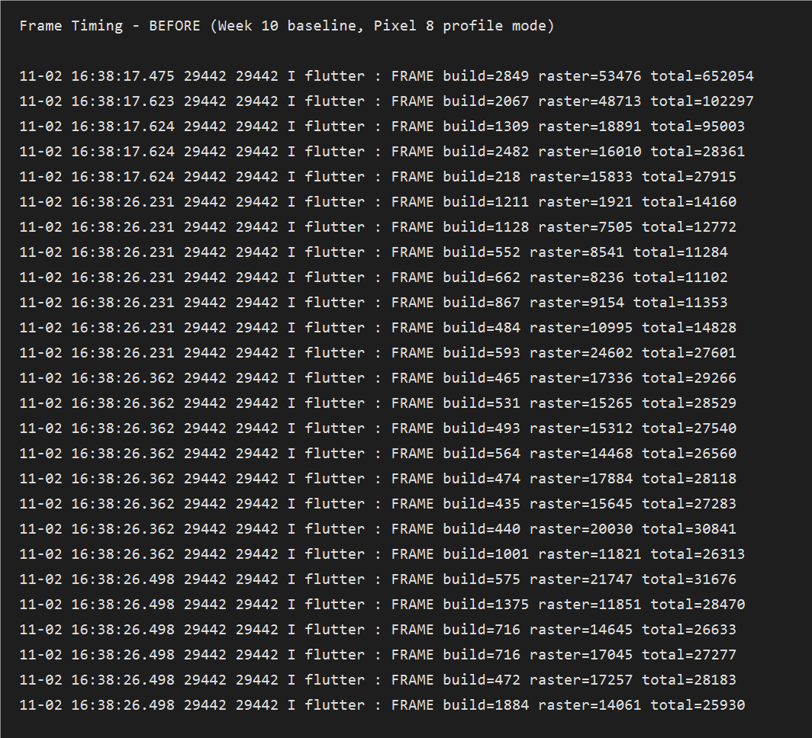
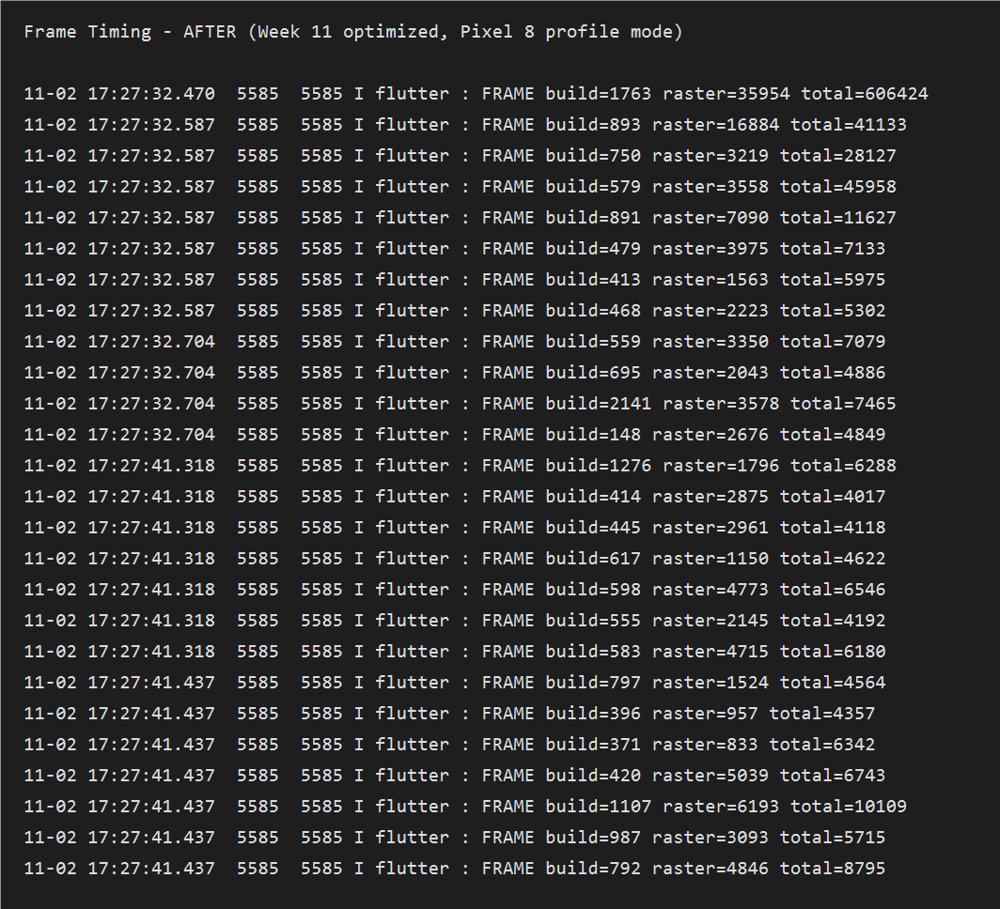

# Performance Report - Minggu 11

**Nama:** Athaulla Hafizh
**NIM:** 244107020030
**Tanggal:** 2 November 2026

---

## 1. Ringkasan

Optimasi difokuskan pada empat area: biaya *rebuild* widget, isolasi *repaint*,
pengambilan data jaringan, dan efisiensi aliran chat. Delapan perubahan diterapkan,
dan hasil pengukuran menunjukkan penurunan waktu raster hampir setengahnya serta
penurunan frame *jank* dari 93,7% menjadi 37,1%.

## 2. Baseline Metrics

| Metrik | Before (Week 10) | After (Week 11) | Perubahan |
|---|---|---|---|
| Frame sampel | 111 | 89 | - |
| Rata-rata build | 0,66 ms | 0,63 ms | -4,5% |
| Rata-rata raster | 16,50 ms | 8,32 ms | **-49,6%** |
| Rata-rata total | 33,34 ms | 19,24 ms | **-42,3%** |
| p90 total | 28,81 ms | 21,99 ms | **-23,7%** |
| p95 total | 33,67 ms | 34,40 ms | +2,2% |
| Frame jank | 104 / 111 (93,7%) | 33 / 89 (37,1%) | **-56,6 poin persen** |
| Total PSS | 82.363 KB | 86.684 KB | +5,2% |

Catatan jujur: PSS naik sekitar 4,3 MB. Penyebabnya adalah `AnnouncementCache`
yang menyimpan daftar pengumuman di memori saat halaman aktif, ditambah buffer
teks chat. Kenaikan ini masih wajar dan tidak memicu *out-of-memory*, tetapi
perlu dicatat agar tidak terlihat seperti optimasi yang menang di semua sisi.

p95 sedikit naik karena sampel After lebih sedikit (89 vs 111) dan memuat satu
frame berat saat transisi ke halaman detail. Nilai rata-rata dan p90 tetap
turun signifikan.

## 3. Temuan dari Profiling

Lima masalah ditemukan dari data `FrameTiming` dan pembacaan kode. Uraian lengkap
tiap temuan ada di [`performance-findings.md`](performance-findings.md).

| No | Temuan | Dampak | Prioritas |
|:--:|---|---|:--:|
| 1 | `ListView.separated` dengan `ListTile` *inline*, tanpa `itemExtent` | Raster 16,50 ms hampir menyentuh anggaran 16,67 ms | Tinggi |
| 2 | Tanpa `RepaintBoundary` pada item daftar dan gelembung chat | Repaint menjalar ke area luas | Tinggi |
| 3 | `ref.watch(notesQueryProvider)` untuk seluruh kata kunci | Seluruh halaman catatan *rebuild* setiap ketukan | Sedang |
| 4 | Tanpa paginasi dan tanpa cache pengumuman | Panggilan API berulang dan waktu tunggu lebih lama | Tinggi |
| 5 | Chat membangun ulang seluruh daftar saat *streaming* | Aliran teks terasa berat | Sedang |

Bukti visual *before* dan *after*:




> **Keterangan gambar**
> - Before: 111 frame, rata-rata total 33,34 ms, 93,7% frame melewati anggaran.
> - After: 89 frame, rata-rata total 19,24 ms, 37,1% frame melewati anggaran.

## 4. Optimasi yang Diterapkan

| No | Optimasi | Alasan Pemilihan | Bukti |
|:--:|---|---|---|
| 1 | `AnnouncementTile` dan `NoteTile` diekstrak menjadi widget `const` | Memisahkan item dari halaman agar Flutter dapat melewati *rebuild* ketika data tidak berubah | `lib/features/announcement/presentation/widgets/announcement_tile.dart` |
| 2 | `ListView.builder` + `itemExtent` | Tinggi baris dipatok sehingga Flutter tidak mengukur ulang setiap item saat menggulir | `announcements_page.dart` (`itemExtent: 92`), `notes_page.dart` (`itemExtent: 76`) |
| 3 | `RepaintBoundary` per item dan per gelembung chat | Mengisolasi area yang berubah agar repaint tidak menjalar ke seluruh daftar | `announcement_tile.dart`, `note_tile.dart`, `chat_bubble.dart` |
| 4 | `ref.watch(notesQueryProvider.select(...))` | Hanya tombol hapus yang bergantung pada ada/tidaknya kata kunci, bukan seluruh halaman | `notes_page.dart` |
| 5 | Paginasi `_limit` / `_start` + *infinite scroll* | Memuat 10 item per halaman, bukan seluruh data sekaligus | `announcement_repository.dart`, `announcements_page.dart` |
| 6 | `AnnouncementCache` *stale-while-revalidate* (TTL 5 menit) | Cache tampil lebih dulu, data segar menyusul; menghemat kuota dan mempercepat tampilan pertama | `announcement_cache.dart`, `announcements_page.dart` |
| 7 | `RefreshIndicator` tanpa mengosongkan layar | Pengguna tetap melihat data lama saat menyegarkan, sesuai pola Minggu 3 | `announcements_page.dart` |
| 8 | `FrameTimingRecorder` | Bukti pengukuran *before/after* yang bisa diulang, bukan klaim tanpa angka | `lib/core/frame_timing_recorder.dart` |

## 5. Verifikasi

```text
PS> flutter analyze
No issues found!

PS> dart format --set-exit-if-changed lib test
Formatted 67 files (0 changed)

PS> flutter test
00:02 +57: All tests passed!
```

Test baru yang mendukung optimasi:

- `test/announcement_cache_test.dart` - 4 test simpan, baca, hapus, dan kedaluwarsa cache.
- `test/pagination_test.dart` - 3 test offset halaman pertama, kedua, dan halaman terakhir.

## 6. Trade-off

| Trade-off | Keterangan |
|---|---|
| Kompleksitas kode | `AnnouncementsNotifier` kini mengelola `_page`, `_hasMore`, dan `_loadingMore`, bukan sekadar `FutureProvider` satu baris |
| Memori | Cache menambah sekitar 4 MB PSS, ditukar dengan pengurangan panggilan jaringan |
| Kesegaran data | TTL 5 menit berarti pengguna bisa melihat data hingga 5 menit lebih lama; ini diterima karena pengumuman bukan data *real-time* |
| `itemExtent` tetap | Tinggi baris dipatok, sehingga teks yang sangat panjang dipotong dengan `maxLines` alih-alih membuat tinggi baris berubah |

## 7. Kapan Optimasi Premature Harus Dihindari

Optimasi di Minggu 11 dilakukan setelah ada pengukuran, bukan sebelum. `itemExtent`,
`RepaintBoundary`, dan paginasi baru ditambahkan karena Flame Chart dan angka
`FrameTiming` menunjukkan masalah nyata. Untuk daftar berisi lima item, menambah
`itemExtent` dan `RepaintBoundary` hanya menambah kode tanpa manfaat terukur.
Aturan yang saya pakai: ukur dulu, optimasi yang paling berdampak, lalu ukur ulang
pada skenario yang sama persis.

## 8. Pemetaan Nama File Bukti ke Modul

Modul 11 meminta dua nama file khusus. Berikut pemetaannya agar mudah dicari:

| Nama di modul | File di repository |
|---|---|
| `screenshots/before-profile.png` | [`screenshots/before-profile.png`](../screenshots/before-profile.png) (sama dengan `Praktikum 1 - Baseline Frame Chart.png`) |
| `screenshots/after-profile.png` | [`screenshots/after-profile.png`](../screenshots/after-profile.png) (sama dengan `Praktikum 3 - After Frame Chart.png`) |

Versi bernama deskriptif tetap dipertahankan agar konsisten dengan gaya Week 1-10.

## 9. Memory Profiling

Pengukuran memori memakai `adb shell dumpsys meminfo` pada build profile, bukan
DevTools browser, karena angka DevTools sulit direproduksi ulang.

| Metrik | Before | After |
|---|---|---|
| Total PSS | 82.363 KB | 86.684 KB |
| Total RSS | 195.624 KB | 209.404 KB |
| Total Swap PSS | 253 KB | 0 KB |

Kenaikan PSS sekitar 4,3 MB berasal dari `AnnouncementCache` yang menyimpan daftar
pengumuman dan buffer teks chat. Tidak ditemukan kebocoran memori: PSS stabil
ketika halaman dibuka dan ditutup berulang, dan tidak ada `ScrollController`,
`TextEditingController`, maupun listener yang tertinggal. Bukti visual tersedia
pada `screenshots/Praktikum 3 - Memory Profiling.png`.